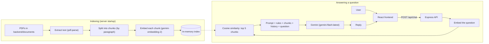

<div align="center">

# 🤖 E-Tanong AI

### AI-powered assistant for government medical assistance requirements


**[🌐 Live Demo](https://e-tanongai.netlify.app/)** · **[🐛 Report a Bug](https://github.com/janrelle24/ai-inquiry-assistant/issues)** · **[💡 Request a Feature](https://github.com/janrelle24/ai-inquiry-assistant/issues)**

<!-- Replace with a real screenshot or GIF of the chat interface -->
<!--  -->

</div>

---

## 📖 About

**E-Tanong AI** (*tanong* means "question" in Filipino) helps people find out **where to apply, which documents to bring, and what the process is** for government medical assistance from the **DSWD, DOH, LGU, and PSWDO**, without digging through lengthy documents or making repeated trips to the office.

It uses **Retrieval-Augmented Generation (RAG)**. Answers are generated only from a curated PDF knowledge base, and the assistant is instructed to reply *"I don't have information about that yet."* when the answer isn't in it, instead of guessing.

The current knowledge base focuses on the **province of Agusan del Norte**.

**Example questions**

> *"What are the requirements for Medicine Assistance?"*
> *"Where can I apply for medical assistance?"*
> *"What documents are required for Hospital Bill Assistance?"*

> [!NOTE]
> E-Tanong AI gives process and requirements guidance only. It does not diagnose conditions or prescribe treatment, and it is not a substitute for official guidance from the agency concerned. Always confirm with the office before you go.

## 📑 Table of Contents

- [Features](#-features)
- [How It Works](#-how-it-works)
- [Tech Stack](#%EF%B8%8F-tech-stack)
- [Project Structure](#-project-structure)
- [Getting Started](#%EF%B8%8F-getting-started)
- [API Reference](#-api-reference)
- [Deployment](#-deployment)
- [Security & Privacy](#-security--privacy)
- [Known Limitations](#-known-limitations)
- [Roadmap](#-roadmap)
- [Author](#-author)

## ✨ Features

**AI & Retrieval**
- 🤖 Conversational assistant powered by Google Gemini
- 📚 RAG over one or more PDFs placed in `backend/documents`
- 🔎 Semantic search using Gemini embeddings and cosine similarity
- 🧠 Short conversation memory per session (last 10 messages)
- 🔁 Automatic retries when the Gemini service is temporarily unavailable

**Chat experience**
- 💬 Chat with a typing indicator, message timestamps, and animated messages
- 💡 Suggested questions in the sidebar
- 📋 One-click copy of AI responses
- 😊 Emoji picker
- 🧹 New Chat with a confirmation prompt

**Interface**
- 🏠 Filipino-language landing page with an animated chat preview, steps, and FAQ
- 🌙 Dark mode, remembered between visits
- 📱 Responsive layout with a mobile sidebar and navigation drawer
- 🛡️ Per-IP rate limiting on the chat endpoint, with a friendly message in the UI

## 🧠 How It Works

The knowledge base is indexed once when the server starts, and each question is matched against that index.



1. **Index:** PDFs are parsed, split into paragraph-sized chunks, and embedded. Chunks and vectors are kept in memory.
2. **Retrieve:** the question is embedded and compared against every chunk. The 5 most similar are selected.
3. **Generate:** the system rules, retrieved context (capped at 12,000 characters), recent conversation (capped at 8,000 characters), and the question are sent to Gemini.
4. **Remember:** the exchange is added to the session's history, keyed by a `sessionId` the frontend generates for each chat.

## 🛠️ Tech Stack

| Layer | Technologies |
|---|---|
| **Frontend** | React 19, Vite, Tailwind CSS 4, React Router, Axios, Framer Motion, Lucide & React Icons |
| **Backend** | Node.js, Express 5, `express-rate-limit`, `cors`, `dotenv` |
| **AI & RAG** | Google Gemini (`@google/genai`), `gemini-embedding-2`, `pdf-parse` |
| **Storage** | PDF knowledge base, in-memory index and conversation history (no database) |
| **Deployment** | Netlify (frontend), Render (backend) |

## 📂 Project Structure

```text
ai-inquiry-assistant/
├── backend/
│   ├── documents/                  # PDF knowledge base (add your .pdf files here)
│   ├── src/
│   │   ├── controllers/
│   │   │   └── chatController.js
│   │   ├── middleware/
│   │   │   └── rateLimiter.js
│   │   ├── prompts/
│   │   │   └── systemPrompt.js     # Assistant rules and persona
│   │   ├── routes/
│   │   │   └── chat.routes.js
│   │   ├── services/
│   │   │   ├── cache.service.js         # In-memory knowledge cache
│   │   │   ├── chunk.service.js         # Text chunking
│   │   │   ├── context.service.js       # Context size limits
│   │   │   ├── conversation.service.js  # Per-session history
│   │   │   ├── embedding.service.js     # Gemini embeddings
│   │   │   ├── gemini.service.js        # RAG pipeline + Gemini calls + retries
│   │   │   ├── index.service.js         # Builds the knowledge index
│   │   │   ├── pdf.service.js           # PDF text extraction
│   │   │   ├── prompt.service.js        # Prompt assembly
│   │   │   └── vector.service.js        # Cosine similarity search
│   │   └── server.js
│   ├── .env.example
│   └── package.json
│
├── frontend/
│   ├── src/
│   │   ├── api/                    # Axios client
│   │   ├── assets/
│   │   ├── components/             # Chat UI, sidebar, navbar, modals
│   │   ├── context/                # Theme (dark mode) provider
│   │   ├── hooks/                  # useChat, useTheme
│   │   ├── pages/                  # LandingPage, Home (chat)
│   │   ├── App.jsx
│   │   └── main.jsx
│   ├── .env.example
│   ├── vite.config.js
│   └── package.json
│
└── README.md
```

## ⚙️ Getting Started

### Prerequisites

- [Node.js](https://nodejs.org/) and npm
- Git
- A [Google Gemini API key](https://aistudio.google.com/app/apikey)
- At least one PDF to use as the knowledge base

### Installation

```bash
# 1. Clone the repository
git clone https://github.com/janrelle24/ai-inquiry-assistant.git
cd ai-inquiry-assistant

# 2. Install backend dependencies
cd backend
npm install

# 3. Install frontend dependencies
cd ../frontend
npm install
```

### Add your knowledge base

Place one or more `.pdf` files in `backend/documents/`. All PDFs in the folder are read and indexed when the server starts. The server stops with an error if none are found.

### Environment variables

**`backend/.env`**

```env
PORT=5000
GEMINI_API_KEY=your_gemini_api_key
```

**`frontend/.env`** (optional locally; required in production)

```env
VITE_API_URL=https://your-backend-url.onrender.com
```

If `VITE_API_URL` is not set, the frontend uses `http://localhost:5000`.

> [!WARNING]
> Never commit your `.env` files. Make sure your `.gitignore` includes:
> ```gitignore
> .env
> node_modules/
> ```

### Run locally

Use two terminals. Start the backend **from the `backend` folder**, because the PDF folder is resolved relative to where the server is launched.

```bash
# Terminal 1: backend (http://localhost:5000)
cd backend
npm run dev
```

```bash
# Terminal 2: frontend (usually http://localhost:5173)
cd frontend
npm run dev
```

On startup the backend logs how many chunks it created and confirms when the knowledge index is built. Requests aren't served until indexing finishes, so large PDFs mean a longer start.

## 🔌 API Reference

### `POST /api/chat`

Sends a question and returns an answer grounded in the knowledge base.

**Request body**

| Field | Type | Required | Description |
|---|---|---|---|
| `message` | string | Yes | The user's question |
| `sessionId` | string | Recommended | Identifies the conversation so follow-up questions have context. The frontend generates a UUID per chat. |

```json
{
  "message": "What are the requirements for Medicine Assistance?",
  "sessionId": "b3f1c2a4-0d7e-4a55-9a1c-2f6a5e8d9c10"
}
```

**Success response: `200`**

```json
{
  "success": true,
  "reply": "• Medical Certificate\n• Valid Government ID\n• Doctor's prescription\n• Barangay Certificate"
}
```

**Errors**

| Status | Meaning |
|---|---|
| `400` | `message` is missing |
| `429` | Too many requests (limit: 50 per IP per 10 minutes) |
| `500` | Server or AI service error |

```json
{
  "success": false,
  "message": "Too many requests. Please try again later."
}
```

### `GET /`

Health check. Returns `{ "success": true, "message": "E-Tanong AI Backend is running 🚀" }`.

## 🚀 Deployment

| Service | Platform | Configuration |
|---|---|---|
| **Frontend** | Netlify | Base directory: `frontend` · Build command: `npm run build` · Publish directory: `dist` · Env: `VITE_API_URL` |
| **Backend** | Render | Root directory: `backend` · Build command: `npm install` · Start command: `npm start` · Env: `GEMINI_API_KEY` |

Make sure the PDFs in `backend/documents/` are included in the deployed repository, since the backend builds its index from them on every start.

Because the app uses client-side routing (`/chat`), add a redirect rule on Netlify so direct visits and refreshes work. Create `frontend/public/_redirects` containing:

```text
/*    /index.html   200
```

## 🔒 Security & Privacy

- The Gemini API key lives only in backend environment variables and is never sent to the browser
- `.env` files are excluded from version control
- All AI requests go through the backend
- The chat endpoint is rate limited per IP
- Conversations are **not saved to a database**. History is held in the server's memory only for the active session (last 10 messages) and is cleared when the server restarts
- The assistant is instructed to answer only from the knowledge base and never to invent information

## ⚠️ Known Limitations

- Answers are only as complete and current as the PDFs in the knowledge base. Always confirm requirements with the agency.
- Retrieval keeps the 5 most similar chunks without a similarity cutoff, so loosely related questions may still pull in marginal context.
- The index lives in memory and is rebuilt on every server start. Free hosting tiers that sleep will re-index on wake-up.
- The attach-image button validates a file but does not send it to the backend yet. Only text is processed.
- CORS currently allows all origins.

## 🔮 Roadmap

**Knowledge & retrieval**
- [ ] Similarity threshold and relevance filtering
- [ ] Persistent vector database
- [ ] PDF upload and knowledge-base management
- [ ] Support for more provinces and agencies

**Product**
- [ ] Render AI replies as Markdown (lists and bold text)
- [ ] Image understanding for photos of documents or IDs
- [ ] Conversation history (opt-in)
- [ ] Voice input
- [ ] English / Filipino language toggle in the chat

**Operations**
- [ ] Restrict CORS to the deployed frontend origin
- [ ] Centralized error handling and request validation middleware
- [ ] Request logging and analytics
- [ ] Automated evaluation of AI responses

## 🎯 Project Goals

E-Tanong AI aims to make public-service information easier to reach through a simple conversational interface. It also demonstrates practical work in full-stack development, REST API design, RAG and semantic search, PDF processing, responsive UI, and cloud deployment.

## 👨‍💻 Author

**Janrelle Lubiano**
Computer Science · Full-Stack Development · AI Applications

[](https://github.com/janrelle24)
[](https://www.linkedin.com/in/janrelle-lubiano-69074b222)

---

<div align="center">

⭐ If you find this project useful, consider giving it a star.

*This project is for educational and demonstration purposes.*

</div>
